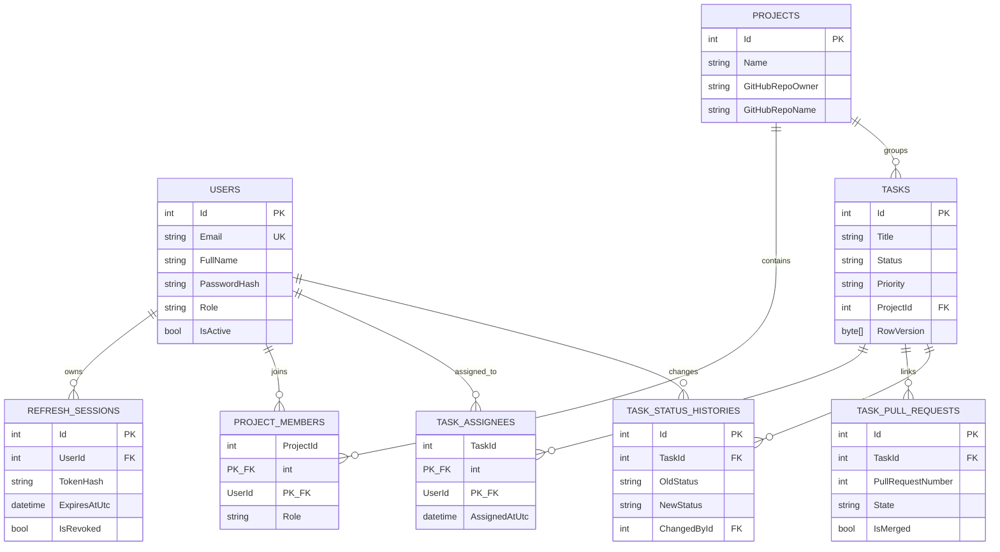

# DevTaskHub: Master Project Presentation & Complete API Guide
*(Enterprise Defense, Evaluation & Full API Reference Manual)*

---

# 📑 Master Table of Contents
1. [Part 1: Executive Presentation Pitch (The 2-Minute Speech)](#part-1-executive-presentation-pitch-the-2-minute-speech)
2. [Part 2: Conceptual Fundamentals (For Evaluators & Viva Basics)](#part-2-conceptual-fundamentals-for-evaluators--viva-basics)
3. [Part 3: Complete Folder-by-Folder Codebase Tour](#part-3-complete-folder-by-folder-codebase-tour)
4. [Part 4: Database Architecture & Complete Table Directory](#part-4-database-architecture--complete-table-directory)
5. [Part 5: The 4 Connection Bridges (How .NET 10 & React 19 Connect)](#part-5-the-4-connection-bridges-how-net-10--react-19-connect)
6. [Part 6: Exhaustive API Catalog (All Core Endpoints Across All 7 Controllers)](#part-6-exhaustive-api-catalog-all-core-endpoints-across-all-7-controllers)
   - Group 1: Authentication & Identity (`AuthApiController.cs`)
   - Group 2: Tasks & Sprint Execution (`TasksApiController.cs`)
   - Group 3: Projects & Team Membership (`ProjectsApiController.cs`)
   - Group 4: GitHub Integration & PR Sync (`GitHubApiController.cs`)
   - Group 5: Executive Dashboard & Metrics (`DashboardApiController.cs`)
   - Group 6: Identity Governance & Users (`UsersApiController.cs`)
   - Group 7: Task Discussions & Comments (`CommentsApiController.cs`)
7. [Part 7: Live Presentation Walkthrough Script (5-Step Live Demo)](#part-7-live-presentation-walkthrough-script-5-step-live-demo)
8. [Part 8: Event-Driven Architecture (EDA) & Apache Kafka (Senior Engineering Review)](#part-8-event-driven-architecture-eda--apache-kafka-senior-engineering-review)
9. [Part 9: Tough Presentation Questions & Winning Defense Answers](#part-9-tough-presentation-questions--winning-defense-answers)

---

# Part 1: Executive Presentation Pitch (The 2-Minute Speech)

If your evaluator, professor, or senior engineer asks: **"What is DevTaskHub and why did you build it?"**, deliver this exact structured response:

> *"Good morning/afternoon. DevTaskHub is an enterprise-grade Software Engineering Task & Sprint Observability platform built for modern development teams.*
>
> *In most engineering teams, there is a dangerous **'Status Sync Gap'**: project managers look at a task board marked 'In Progress', but on GitHub, the pull request was already merged or closed hours ago. Developers waste hours manually copying links, context switching, and updating statuses across disjointed tools.*
>
> *We built DevTaskHub to bridge that gap. It combines:*
> 1. *A **reactive React 19 TypeScript Kanban board** with multi-member task assignees and real-time sorting.*
> 2. *A **high-throughput ASP.NET Core 10 Web API** backed by SQL Server Express with optimistic concurrency control (`RowVersion`).*
> 3. *A **secure GitHub REST API v3 proxy** that links sprint tasks directly to live Pull Requests, syncing real-time merge statuses while defending against GitHub rate limits using in-memory caching.*
> 4. *A **Bank-Grade Dual-Token Authentication model**: short-lived JWT access tokens stored strictly in JavaScript RAM (zero `localStorage` XSS risk), paired with long-lived rotating refresh tokens in `HttpOnly`, `SameSite=Lax`, `Secure` cookies.*
> 5. *Production hosting in **Windows IIS (In-Process)** with custom domain resolution and TLS encryption at `https://app.devtaskhub.local` on standard Port 443.*
>
> *Today, I will walk you through the end-to-end architecture, the complete database schema, our comprehensive REST API catalog, and a live demonstration."*

---

# Part 2: Conceptual Fundamentals (For Evaluators & Viva Basics)

### 1. What is an API and Why Do We Use It?
* **What is it?** An **API** (Application Programming Interface) is a standardized contract and communication bridge allowing two distinct systems—such as our React browser client and our ASP.NET Core backend—to securely exchange data over HTTP.
* **Why can't React talk directly to SQL Server?**
  1. **Security Vulnerability:** If React connected directly to SQL Server, the database connection string, database password, and table access would be exposed to anyone inspecting the browser.
  2. **Business Rules Enforcement:** Databases store data, but cannot enforce business workflows (e.g. verifying project membership before assigning a task, evaluating cryptographic token claims, or contacting GitHub to check PR merge flags).
  3. **Decoupled Architecture:** The ASP.NET Core Web API acts as a secure intermediary and validation layer. It accepts requests, checks permissions, executes transactions, and returns clean, filtered JSON.

### 2. How Does HTTP Communication Work?
* **Request-Response Lifecycle:** The React client initiates an HTTP request (Method + URL + Headers + Body). IIS receives it on Port 443, passes it to the ASP.NET Core in-process engine, which routes it to a Controller. The Controller calls a Service, queries EF Core, and returns an HTTP response (Status Code + Headers + JSON Body).
* **HTTP Verbs Used:**
  - `GET`: Read / Retrieve records without modifying state (e.g. `GET /api/tasks`).
  - `POST`: Create a new record or trigger an action (e.g. `POST /api/tasks`, `POST /api/auth/login`).
  - `PUT`: Update / Replace an existing record (e.g. `PUT /api/tasks/19`).
  - `PATCH`: Partially update specific fields (e.g. `PATCH /api/users/2/role`).
  - `DELETE`: Remove a record (e.g. `DELETE /api/tasks/19/github/unlink`).

### 3. What is JSON and How Does Serialization Bridge C# and TypeScript?
* **JSON (JavaScript Object Notation):** The lightweight text standard used for wire transmission.
* **Serialization Policy:** C# models use **PascalCase** (`public string Title { get; set; }`). TypeScript models use **camelCase** (`title: string`). In `Program.cs`, ASP.NET Core's `System.Text.Json` is configured with camelCase naming policy, automatically converting `TaskDto.Title` to `"title"` on output and vice versa on input.

---

# Part 3: Complete Folder-by-Folder Codebase Tour

### 1. `DevTaskHub.Client/src/` (Frontend React 19 + Vite + Strict TypeScript)
* **`components/layout/`**: Structural layout containers.
  - `AppLayout/AppLayout.tsx`: Master page layout containing Sidebar, Navbar, and `<Outlet />`.
  - `Navbar/Navbar.tsx`: Top header with active enterprise branding and profile dropdown.
  - `Sidebar/Sidebar.tsx`: Left navigational rail for Dashboard, Projects, Tasks, Users.
* **`components/tasks/`**: Sprint execution components.
  - `TaskCard/TaskCard.tsx`: Draggable Kanban card rendering priority chips, PR pills, and overlapping member avatars.
  - `TaskDetailDrawer/TaskDetailDrawer.tsx`: Slide-out panel for task editing, co-assignee management (`✕` remove / `+ Add Co-Assignee`), team discussion comments, status audit logs, and GitHub PR link/sync.
  - `TaskForm/TaskForm.tsx`: Modal form for task creation with multi-assignee pills.
* **`pages/`**: Primary route views.
  - `DashboardPage.tsx`: Engineering observatory with sprint velocity KPIs, project delivery progress meters, and recent activity timeline.
  - `TasksPage.tsx`: Full Kanban board with multi-attribute sorting and project filters.
  - `ProjectsPage.tsx`: Grid view of all repositories and projects.
  - `UsersPage.tsx`: Admin-only identity governance console for role assignment and deactivation.
* **`context/`**: Global state providers.
  - `AuthContext.tsx`: Holds in-memory user details and triggers silent token restoration on boot.
* **`services/`**: API communication layer.
  - `api.ts`: Configured Axios client with in-memory Bearer token injection and automated 401 refresh interceptors.
  - `auth.service.ts`, `task.service.ts`, `project.service.ts`, `github.service.ts`, `user.service.ts`: Type-safe API consumer methods.

### 2. `DevTaskHub.Web/` (Backend ASP.NET Core 10 Web API)
* **`Controllers/Api/`**: REST API controllers handling HTTP requests and delegating to services.
* **`Services/`**: Core business logic layer.
  - `TaskService.cs`: Enforces project membership assignment rules, executes LINQ queries, tracks status changes.
  - `GitHubService.cs`: Manages GitHub API HTTP calls, 10-minute in-memory caching (`IMemoryCache`), and `merged` vs `closed` state detection.
  - `AuthService.cs`: PBKDF2 password hashing (100,000 iterations), credential verification, refresh session lifecycle.
  - `JwtTokenGenerator.cs`: Encodes claims (`UserId`, `Role`, `Email`) and signs tokens using HMAC-SHA256.
* **`Data/`**:
  - `ApplicationDbContext.cs`: EF Core database context configuring entity tables, composite keys, cascade rules, and indexes.
* **`Entities/`**: Database domain entities (`User.cs`, `Project.cs`, `TaskItem.cs`, `TaskAssignee.cs`, `TaskPullRequest.cs`, `TaskComment.cs`, `TaskStatusHistory.cs`, `RefreshSession.cs`).
* **`DTOs/`**: Data Transfer Objects preventing internal secret leakage and circular JSON loops.
* **`Program.cs`**: Boots DI container, middleware pipeline, static files, and SPA fallback.
* **`web.config`**: In-process IIS hosting configuration with `ASPNETCORE_ENVIRONMENT=Development` and WebDAV removal.

---

# Part 4: Database Architecture & Complete Table Directory

The database is **`DevTaskHubDb`** hosted on SQL Server Express (`.\SQLEXPRESS01`). It uses Microsoft Entity Framework Core with Code-First migrations.



### Table Directory
1. **`dbo.Users`**: Registered developers and administrators. Passwords hashed using PBKDF2 (100,000 iterations).
2. **`dbo.Projects`**: Workspaces linking tasks to GitHub repositories (`GitHubRepoOwner`, `GitHubRepoName`).
3. **`dbo.ProjectMembers`**: Composite primary key `[ProjectId, UserId]`. Enforces that tasks can only be assigned to members of that project.
4. **`dbo.Tasks`**: Core sprint items with status (`Todo`, `InProgress`, `InReview`, `Done`), priority, and `RowVersion` for optimistic concurrency control.
5. **`dbo.TaskAssignees`**: Composite primary key `[TaskId, UserId]`. Enables multi-member task assignment.
6. **`dbo.TaskPullRequests`**: Links tasks to GitHub PR numbers, titles, states (`open`, `closed`, `merged`), and sync timestamps.
7. **`dbo.TaskStatusHistories`**: Audit trail logging every movement of a task across Kanban columns.
8. **`dbo.RefreshSessions`**: Stores hashed refresh tokens and expirations for silent token rotation.

---

# Part 5: The 4 Connection Bridges (How .NET 10 & React 19 Connect)

1. **The Hosting Bridge (Single-Origin in IIS):**  
   Both React static files and C# Web API live on `https://app.devtaskhub.local` on standard Port 443. This completely eliminates CORS in production. `app.MapFallbackToFile("index.html")` enables client-side React Router navigation.
2. **The Protocol Bridge (Axios HTTP Client):**  
   Centralized Axios client (`api.ts`) injects the in-memory Bearer token on every outgoing request and intercepts 401s to trigger silent token rotation via the background refresh cookie.
3. **The Contract Bridge (C# DTOs ↔ TypeScript Interfaces):**  
   Every C# DTO has an exact twin interface in TypeScript, with automatic PascalCase to camelCase conversion.
4. **The Security Bridge (Dual-Token + PBKDF2):**  
   Short-lived JWT access tokens are kept strictly in private JavaScript runtime memory (zero `localStorage` XSS risk). Long-lived refresh tokens are stored in an `HttpOnly`, `SameSite=Lax`, `Secure` cookie.

---

# Part 6: Exhaustive API Catalog (All Core Endpoints Across All 7 Controllers)

---

## Group 1: Authentication & Identity (`AuthApiController.cs`)
*Base Route:* `/api/auth` | *File:* [`DevTaskHub.Web/Controllers/Api/AuthApiController.cs`](file:///C:/Users/Potenza/source/repos/DevTaskHub/DevTaskHub.Web/DevTaskHub.Web/Controllers/Api/AuthApiController.cs)

### 1.1 Register User
* **Method & Route:** `POST /api/auth/register` (Line 25)
* **Access:** Anonymous (Public)
* **Purpose:** Registers a new enterprise account with salted PBKDF2 password hashing.
* **Request Input Body (`RegisterRequestDto`):**
  ```json
  {
    "fullName": "Aashutosh Yadav",
    "email": "aashutosh@devtaskhub.com",
    "password": "Password123!",
    "role": "Developer",
    "gitHubUsername": "YadavAashutosh"
  }
  ```
* **Success Response (`201 Created` - `UserDto`):**
  ```json
  {
    "userId": 1,
    "fullName": "Aashutosh Yadav",
    "email": "aashutosh@devtaskhub.com",
    "role": "Developer",
    "gitHubUsername": "YadavAashutosh",
    "isActive": true,
    "createdAt": "2026-11-03T10:00:00Z"
  }
  ```
* **Error Responses:** `400 Bad Request` (Email already registered or validation failed).

---

### 1.2 Login User
* **Method & Route:** `POST /api/auth/login` (Line 50)
* **Access:** Anonymous (Public)
* **Purpose:** Verifies PBKDF2 hash, issues short-lived in-memory JWT, and attaches `HttpOnly` refresh cookie.
* **Request Input Body (`LoginRequestDto`):**
  ```json
  {
    "email": "PotenzaDev@gmail.com",
    "password": "Password123!"
  }
  ```
* **Success Response (`200 OK` - `AuthResponseDto`):**
  *Headers:* `Set-Cookie: refreshToken=...; HttpOnly; Secure; SameSite=Lax; Path=/api/auth`
  *Body:*
  ```json
  {
    "token": "eyJhbGciOiJIUzI1NiIsInR5cCI6IkpXVCJ9...",
    "refreshToken": "7c9f8a2e1d...",
    "tokenType": "Bearer",
    "expiresIn": 3600,
    "user": {
      "userId": 1,
      "fullName": "PotenzaDev",
      "email": "PotenzaDev@gmail.com",
      "role": "Admin",
      "isActive": true
    }
  }
  ```
* **Error Responses:** `401 Unauthorized` (Invalid credentials), `403 Forbidden` (Account deactivated).

---

### 1.3 Refresh Access Token
* **Method & Route:** `POST /api/auth/refresh` (Line 85)
* **Access:** Anonymous (Requires valid `refreshToken` cookie or body)
* **Purpose:** Silent token rotation. Mints a fresh JWT access token without logging out the user.
* **Request Input Body:** Empty body (reads from `HttpOnly` cookie).
* **Success Response (`200 OK` - `AuthResponseDto`):** Fresh JWT token and rotated cookie.
* **Error Responses:** `401 Unauthorized` (Token expired or revoked).

---

### 1.4 Logout User
* **Method & Route:** `POST /api/auth/logout` (Line 120)
* **Access:** Anonymous / Authenticated
* **Purpose:** Clears the `refreshToken` cookie by expiring it immediately (`Expires = DateTime.UtcNow.AddDays(-1)`).
* **Success Response (`200 OK`):** `{ "message": "Logged out successfully." }`

---

## Group 2: Tasks & Sprint Execution (`TasksApiController.cs`)
*Base Route:* `/api/tasks` | *File:* [`DevTaskHub.Web/Controllers/Api/TasksApiController.cs`](file:///C:/Users/Potenza/source/repos/DevTaskHub/DevTaskHub.Web/DevTaskHub.Web/Controllers/Api/TasksApiController.cs)

### 2.1 Get All Tasks (Filtered & Sorted)
* **Method & Route:** `GET /api/tasks` (Line 42)
* **Access:** `[Authorize]`
* **Query Parameters (`TaskQueryFilter`):**
  - `projectId` (int, optional)
  - `status` (string: `Todo`, `InProgress`, `InReview`, `Done`)
  - `priority` (string: `Low`, `Medium`, `High`)
  - `search` (string: searches Title and Description)
* **Success Response (`200 OK` - `List<TaskDto>`):**
  ```json
  [
    {
      "id": 19,
      "title": "IIS Deployment & Hosting",
      "description": "Configure IIS on port 443 with HTTPS",
      "status": "InProgress",
      "priority": "High",
      "projectId": 2,
      "projectName": "DevTask Hub Web",
      "assignees": [
        { "userId": 1, "fullName": "PotenzaDev", "role": "Admin" },
        { "userId": 2, "fullName": "dev1", "role": "Developer" }
      ],
      "gitHubPrNumber": 7,
      "gitHubPrStatus": "merged",
      "gitHubPrIsMerged": true,
      "createdAt": "2026-11-03T10:00:00Z"
    }
  ]
  ```

---

### 2.2 Get Task By ID
* **Method & Route:** `GET /api/tasks/{id:int}` (Line 55)
* **Access:** `[Authorize]`
* **Route Param:** `id` (e.g. `19`)
* **Success Response (`200 OK` - `TaskDto`):** Single task object with full details.
* **Error Responses:** `404 NotFound` (Task does not exist).

---

### 2.3 Create Task (With Multi-Assignees)
* **Method & Route:** `POST /api/tasks` (Line 71)
* **Access:** `[Authorize]`
* **Purpose:** Creates a new task. Enforces that all `assignedUserIds` must be active members of `projectId`.
* **Request Input Body (`CreateTaskDto`):**
  ```json
  {
    "title": "Implement Webhooks",
    "description": "Add GitHub webhook listener endpoint",
    "priority": "High",
    "projectId": 2,
    "dueDate": "2026-11-10T00:00:00Z",
    "assignedUserIds": [1, 2]
  }
  ```
* **Success Response (`201 Created` - `TaskDto`):** Newly created task object with generated ID.
* **Error Responses:** `400 Bad Request` (Assignee is not a member of the project or title is blank).

---

### 2.4 Update Task (Status, Assignees, Details)
* **Method & Route:** `PUT /api/tasks/{id:int}` (Line 102)
* **Access:** `[Authorize]`
* **Route Param:** `id` (e.g. `19`)
* **Request Input Body (`UpdateTaskDto`):**
  ```json
  {
    "title": "IIS Deployment & Hosting",
    "description": "Updated configuration details",
    "status": "Done",
    "priority": "High",
    "dueDate": "2026-11-06T00:00:00Z",
    "assignedUserIds": [1],
    "rowVersion": "AAAAAAAAB9Q="
  }
  ```
* **Success Response (`200 OK` - `TaskDto`):** Updated task object.
* **Error Responses:** `400 Bad Request` (Invalid assignee or status), `409 Conflict` (RowVersion concurrency conflict).

---

### 2.5 Delete Task
* **Method & Route:** `DELETE /api/tasks/{id:int}` (Line 145)
* **Access:** `[Authorize(Roles = "Admin")]`
* **Success Response (`204 NoContent`):** Empty body.
* **Error Responses:** `403 Forbidden` (Non-admin), `404 NotFound`.

---

### 2.6 Get Task Status Audit History
* **Method & Route:** `GET /api/tasks/{id:int}/history` (Line 164)
* **Access:** `[Authorize]`
* **Success Response (`200 OK` - `List<TaskStatusHistoryDto>`):**
  ```json
  [
    {
      "id": 1,
      "taskId": 19,
      "oldStatus": "Todo",
      "newStatus": "InProgress",
      "changedByName": "PotenzaDev",
      "changedAtUtc": "2026-11-03T11:00:00Z"
    }
  ]
  ```

---

## Group 3: Projects & Team Membership (`ProjectsApiController.cs`)
*Base Route:* `/api/projects` | *File:* [`DevTaskHub.Web/Controllers/Api/ProjectsApiController.cs`](file:///C:/Users/Potenza/source/repos/DevTaskHub/DevTaskHub.Web/DevTaskHub.Web/Controllers/Api/ProjectsApiController.cs)

### 3.1 Get All Projects
* **Method & Route:** `GET /api/projects` (Line 39)
* **Access:** `[Authorize]`
* **Success Response (`200 OK` - `List<ProjectDto>`):**
  ```json
  [
    {
      "id": 2,
      "name": "DevTask Hub Web",
      "description": "Full-stack enterprise task tracking system",
      "gitHubRepoOwner": "YadavAashutosh",
      "gitHubRepoName": "DevTaskHub",
      "totalTasks": 4,
      "completedTasks": 2,
      "totalMembers": 3
    }
  ]
  ```

### 3.2 Get Project By ID
* **Method & Route:** `GET /api/projects/{id:int}` (Line 92)
* **Access:** `[Authorize]`
* **Success Response (`200 OK` - `ProjectDto`):** Detailed project model with member roster.

### 3.3 Create Project
* **Method & Route:** `POST /api/projects` (Line 141)
* **Access:** `[Authorize(Roles = "Admin,ProjectManager")]`
* **Request Input Body (`CreateProjectDto`):**
  ```json
  {
    "name": "Cloud Observability",
    "description": "Microservices monitoring",
    "gitHubRepoOwner": "YadavAashutosh",
    "gitHubRepoName": "CloudMonitoring"
  }
  ```
* **Success Response (`201 Created` - `ProjectDto`):** Created project object.

### 3.4 Update Project
* **Method & Route:** `PUT /api/projects/{id:int}` (Line 200)
* **Access:** `[Authorize(Roles = "Admin,ProjectManager")]`
* **Success Response (`200 OK` - `ProjectDto`):** Updated project.

### 3.5 Delete Project
* **Method & Route:** `DELETE /api/projects/{id:int}` (Line 238)
* **Access:** `[Authorize(Roles = "Admin")]`
* **Success Response (`204 NoContent`):** Empty body.

### 3.6 Get Project Members
* **Method & Route:** `GET /api/projects/{projectId:int}/members` (Line 266)
* **Access:** `[Authorize]`
* **Purpose:** Returns active project members. Used by `TaskDetailDrawer.tsx` to populate "+ Add Co-Assignee".
* **Success Response (`200 OK` - `List<ProjectMemberDto>`):**
  ```json
  [
    {
      "userId": 1,
      "fullName": "PotenzaDev",
      "email": "PotenzaDev@gmail.com",
      "role": "Admin"
    }
  ]
  ```

### 3.7 Add Member to Project
* **Method & Route:** `POST /api/projects/{projectId:int}/members` (Line 301)
* **Access:** `[Authorize(Roles = "Admin,ProjectManager")]`
* **Request Input Body (`AddProjectMemberDto`):** `{ "userId": 2, "projectRole": "Contributor" }`
* **Success Response (`201 Created`):** Member association created.

### 3.8 Remove Member from Project
* **Method & Route:** `DELETE /api/projects/{projectId:int}/members/{userId:int}` (Line 364)
* **Access:** `[Authorize(Roles = "Admin,ProjectManager")]`
* **Success Response (`204 NoContent`):** Empty body.

---

## Group 4: GitHub Integration & PR Sync (`GitHubApiController.cs`)
*Base Route:* `/api` | *File:* [`DevTaskHub.Web/Controllers/Api/GitHubApiController.cs`](file:///C:/Users/Potenza/source/repos/DevTaskHub/DevTaskHub.Web/DevTaskHub.Web/Controllers/Api/GitHubApiController.cs)

### 4.1 Link PR to Task
* **Method & Route:** `POST /api/tasks/{taskId:int}/github/link` (Line 109)
* **Access:** `[Authorize]`
* **Request Input Body (`LinkPullRequestDto`):**
  ```json
  {
    "pullRequestUrl": "https://github.com/YadavAashutosh/DevTaskHub/pull/7"
  }
  ```
* **Success Response (`200 OK` - `TaskPullRequestDto`):**
  ```json
  {
    "id": 1,
    "taskId": 19,
    "pullRequestNumber": 7,
    "pullRequestUrl": "https://github.com/YadavAashutosh/DevTaskHub/pull/7",
    "title": "refactor: connect TaskCard to TasksPage",
    "state": "merged",
    "isMerged": true,
    "lastSyncedAtUtc": "2026-11-03T12:30:00Z"
  }
  ```

### 4.2 Sync PR Status Live
* **Method & Route:** `POST /api/tasks/{taskId:int}/github/sync` (Line 162)
* **Access:** `[Authorize]`
* **Query Parameter:** `prNumber` (int, e.g. `?prNumber=7`)
* **Purpose:** Invalidates in-memory cache, queries GitHub API live, updates SQL Server, and returns fresh status.
* **Success Response (`200 OK` - `TaskPullRequestDto`):** Fresh PR record.
* **Error Responses:** `429 Too Many Requests` (GitHub API rate limit exhausted).

### 4.3 Unlink PR from Task
* **Method & Route:** `DELETE /api/tasks/{taskId:int}/github/unlink` (Line 198)
* **Access:** `[Authorize]`
* **Query Parameter:** `prNumber` (int, optional)
* **Success Response (`200 OK`):** `{ "message": "Pull Request unlinked from Task #19 successfully." }`

### 4.4 Get Linked PRs for Task
* **Method & Route:** `GET /api/tasks/{taskId:int}/github/prs` (Line 151)
* **Access:** `[Authorize]`
* **Success Response (`200 OK` - `List<TaskPullRequestDto>`):** Array of linked PRs.

---

## Group 5: Executive Dashboard & Metrics (`DashboardApiController.cs`)
*Base Route:* `/api/dashboard` | *File:* [`DevTaskHub.Web/Controllers/Api/DashboardApiController.cs`](file:///C:/Users/Potenza/source/repos/DevTaskHub/DevTaskHub.Web/DevTaskHub.Web/Controllers/Api/DashboardApiController.cs)

### 5.1 Get Dashboard Statistics
* **Method & Route:** `GET /api/dashboard/stats` (Line 21)
* **Access:** `[Authorize]`
* **Success Response (`200 OK` - `DashboardStatsDto`):**
  ```json
  {
    "totalTasks": 12,
    "inProgressTasks": 4,
    "inReviewTasks": 3,
    "completedTasks": 3,
    "totalProjects": 9,
    "overallCompletionRate": 25.0,
    "projectProgress": [
      {
        "projectId": 1,
        "projectName": "Classification-of-Flower",
        "gitHubRepo": "PatelUdit15/Classification-of-Flower",
        "completedTasks": 1,
        "totalTasks": 1,
        "completionPercentage": 100.0
      },
      {
        "projectId": 2,
        "projectName": "DevTask Hub Web",
        "gitHubRepo": "YadavAashutosh/DevTaskHub",
        "completedTasks": 2,
        "totalTasks": 4,
        "completionPercentage": 50.0
      }
    ],
    "recentActivities": [
      {
        "id": 1,
        "action": "PotenzaDev updated 'Testing 2': Moved to InProgress",
        "timestamp": "2026-11-04T06:00:00Z"
      }
    ]
  }
  ```

---

## Group 6: Identity Governance & Users (`UsersApiController.cs`)
*Base Route:* `/api/users` | *File:* [`DevTaskHub.Web/Controllers/Api/UsersApiController.cs`](file:///C:/Users/Potenza/source/repos/DevTaskHub/DevTaskHub.Web/DevTaskHub.Web/Controllers/Api/UsersApiController.cs)

### 6.1 Get Users List
* **Method & Route:** `GET /api/users` (Line 47)
* **Access:** `[Authorize]`
* **Query Params:** `role`, `isActive`, `search`
* **Success Response (`200 OK` - `List<UserDto>`):** Sanitized list of users.

### 6.2 Get Current User Profile
* **Method & Route:** `GET /api/users/me` (Line 96)
* **Access:** `[Authorize]`
* **Success Response (`200 OK` - `UserDto`):** Current user profile extracted from JWT claims.

### 6.3 Update GitHub Handle
* **Method & Route:** `PATCH /api/users/me/github` (Line 122)
* **Access:** `[Authorize]`
* **Request Input Body:** `{ "gitHubUsername": "PotenzaDev" }`
* **Success Response (`200 OK`):** Updated profile.

### 6.4 Update User Role
* **Method & Route:** `PATCH /api/users/{id:int}/role` (Line 157)
* **Access:** `[Authorize(Roles = "Admin")]`
* **Request Input Body (`UpdateUserRoleDto`):** `{ "role": "ProjectManager" }`
* **Success Response (`204 NoContent`):** Empty body.

### 6.5 Update User Status (Activate/Deactivate)
* **Method & Route:** `PATCH /api/users/{id:int}/status` (Line 182)
* **Access:** `[Authorize(Roles = "Admin")]`
* **Request Input Body:** `{ "isActive": false }`
* **Success Response (`204 NoContent`):** Empty body.

---

## Group 7: Task Discussions & Comments (`CommentsApiController.cs`)
*Base Route:* `/api/tasks/{taskId:int}/comments` | *File:* [`DevTaskHub.Web/Controllers/Api/CommentsApiController.cs`](file:///C:/Users/Potenza/source/repos/DevTaskHub/DevTaskHub.Web/DevTaskHub.Web/Controllers/Api/CommentsApiController.cs)

### 7.1 Get Task Comments
* **Method & Route:** `GET /api/tasks/{taskId:int}/comments` (Line 45)
* **Access:** `[Authorize]`
* **Success Response (`200 OK` - `List<TaskCommentDto>`):** Chronological comment stream.

### 7.2 Add Comment to Task
* **Method & Route:** `POST /api/tasks/{taskId:int}/comments` (Line 69)
* **Access:** `[Authorize]`
* **Request Input Body (`CreateCommentDto`):** `{ "content": "PR #7 is tested and ready to merge." }`
* **Success Response (`201 Created` - `TaskCommentDto`):** Created comment with author details.

### 7.3 Edit Comment
* **Method & Route:** `PUT /api/tasks/{taskId:int}/comments/{commentId:int}` (Line 112)
* **Access:** `[Authorize]`
* **Success Response (`200 OK`):** Updated comment.

### 7.4 Delete Comment
* **Method & Route:** `DELETE /api/tasks/{taskId:int}/comments/{commentId:int}` (Line 156)
* **Access:** `[Authorize]`
* **Success Response (`204 NoContent`):** Empty body.

---

# Part 7: Live Presentation Walkthrough Script (5-Step Live Demo)

Follow these 5 steps during your live presentation to demonstrate full mastery:

1. **Step 1: The Secure Entry (`https://app.devtaskhub.local`)**
   - Open browser to `https://app.devtaskhub.local`.
   - Point to the address bar: *"Notice there is no port number—it runs on default HTTPS Port 443 with an active TLS certificate."*
   - Log in with `PotenzaDev@gmail.com`. Open DevTools (`F12`) → Application tab → Storage:
   - Point to `localStorage`: *"Notice localStorage is 100% empty. We store our JWT strictly in JavaScript memory to eliminate XSS risks."*
   - Point to `Cookies`: *"Notice our `refreshToken` cookie is marked `HttpOnly`, `SameSite=Lax`, and `Secure`."*

2. **Step 2: The Executive Dashboard**
   - Show velocity KPIs: Total Tasks (12), In Progress (4), In Review (3), Completed (3).
   - Show Project Delivery Progress bars (Classification-of-Flower at 100%, DevTask Hub Web at 50%).
   - Show live activity stream.

3. **Step 3: The Multi-Assignee Kanban Board**
   - Navigate to `/tasks`.
   - Show Task #19: point out the overlapping avatar stack (`PotenzaDev` & `dev1`).
   - Drag a card from `Todo` to `InProgress`. Explain: *"This dispatches an asynchronous HTTP PUT request that updates the database and creates an audit entry in `dbo.TaskStatusHistories` in under 10 milliseconds."*

4. **Step 4: The Project Membership Security Enforcement**
   - Click Task #20 (*Classification-of-Flower*).
   - Show that `+ Add Co-Assignee` is hidden. Explain: *"Our backend enforces a strict business rule: tasks can only be assigned to active members of that project. Because PotenzaDev is the sole member of this project and already assigned, the system prevents invalid assignments."*
   - Open Task #19 (*DevTask Hub Web*): Show `+ Add Co-Assignee` is visible because `Diwakar` is an unassigned member of this project.

5. **Step 5: The Real-Time GitHub PR Link & Sync**
   - In Task #19 drawer, show the GitHub Pull Request badge: `MERGED PR #7`.
   - Click **Sync**: show how the system invalidates in-memory cache, queries GitHub API live, updates SQL Server, and returns live status.

---

# Part 8: Event-Driven Architecture (EDA) & Apache Kafka (Senior Engineering Review)

*(Special study requested by Senior Engineers Nilesh Parmar & Aashutosh Yadav)*

### 1. Synchronous REST vs. Event-Driven Architecture (EDA)

| Dimension | Current DevTaskHub (Synchronous REST) | Event-Driven Architecture (EDA / Kafka) |
| :--- | :--- | :--- |
| **Communication Style** | **Request-Response (Polling):** React asks: *"Did PR #7 merge yet?"* Backend asks GitHub: *"Did PR #7 merge yet?"* | **Publish-Subscribe (Push):** GitHub announces: *"PR #7 was merged!"* The message broker pushes the event to all subscribers instantly. |
| **Coupling** | **Tight:** Frontend depends on Backend; Backend depends on GitHub API availability. | **Loose:** Producer and consumers know nothing about each other. They only know the event format. |
| **Failure Tolerance** | If GitHub API is down or rate-limited (HTTP 429), the user's sync fails immediately. | If a consumer crashes, events wait safely on the Kafka log without data loss until the consumer recovers. |
| **Scalability** | High traffic can overwhelm the API server and database connections. | Events are buffered in Kafka partitions and processed at consumer capacity. |

---

### 2. Apache Kafka Explained in Real Terms

Imagine a **central physical logbook** inside an engineering office:

```
┌────────────────────────────────────────────────────────────────────────────────────────┐
│                                 APACHE KAFKA BROKER                                    │
│                                                                                        │
│   TOPIC: "github-pr-events"                                                            │
│   ┌────────────────────────────────────────────────────────────────────────────────┐   │
│   │ PARTITION 0: [Event #1] ──▶ [Event #2] ──▶ [Event #3] ──▶ [Event #4 (Latest)]   │   │
│   └────────────────────────────────────────────────────────────────────────────────┘   │
│                                      ▲                                                 │
│                                      │ (Offset: 0, 1, 2, 3...)                         │
└──────────────────────────────────────┼─────────────────────────────────────────────────┘
                                       │
            ┌──────────────────────────┴──────────────────────────┐
            │                                                     │
    PRODUCER: GitHub Webhook                              CONSUMER GROUP: DevTaskHub
    When developer merges PR on GitHub,                   Reads Event #4:
    Webhook POSTs payload to Kafka.                       1. Updates SQL Server (dbo.Tasks)
                                                          2. Pushes WebSocket update to React
```

* **Topic:** A named category or feed where events are stored (e.g. `github-pr-events`, `task-status-changed`).
* **Producer:** Any application that creates and sends events to a topic (e.g. a GitHub Webhook handler).
* **Consumer:** An application that listens to a topic and reacts to incoming events (e.g. a background worker updating the database).
* **Broker:** A Kafka server instance that maintains the distributed commit log.
* **Partition:** A subdivision of a topic that guarantees ordered event processing and allows parallel scaling across multiple servers.
* **Offset:** A sequential integer assigned to each event in a partition (like page numbers in a book), tracking exactly which events a consumer has finished reading.

---

### 3. How DevTaskHub Could Implement EDA with GitHub Webhooks & Kafka

Instead of manual "Sync PR" button clicks, DevTaskHub could be upgraded to full Event-Driven Architecture:

```csharp
// 1. GITHUB WEBHOOK CONTROLLER (The Kafka Producer)
[HttpPost("/api/webhooks/github")]
public async Task<IActionResult> HandleGitHubWebhook([FromBody] GitHubWebhookPayload payload)
{
    // When PR is merged on GitHub, produce an event to Kafka topic:
    var prEvent = new PullRequestMergedEvent {
        Repo = payload.Repository.FullName,
        PrNumber = payload.PullRequest.Number,
        MergedAt = DateTime.UtcNow
    };
    
    await _kafkaProducer.ProduceAsync("github-pr-events", new Message<string, string> {
        Key = payload.PullRequest.Number.ToString(),
        Value = JsonSerializer.Serialize(prEvent)
    });

    return Accepted(); // Instant HTTP 202 response to GitHub
}

// 2. BACKGROUND WORKER (The Kafka Consumer)
public class GitHubEventConsumer : BackgroundService
{
    protected override async Task ExecuteAsync(CancellationToken stoppingToken)
    {
        var consumer = new ConsumerBuilder<string, string>(_consumerConfig).Build();
        consumer.Subscribe("github-pr-events");

        while (!stoppingToken.IsCancellationRequested)
        {
            var result = consumer.Consume(stoppingToken);
            var prEvent = JsonSerializer.Deserialize<PullRequestMergedEvent>(result.Message.Value);

            // Update SQL Server automatically:
            using var scope = _serviceProvider.CreateScope();
            var db = scope.ServiceProvider.GetRequiredService<ApplicationDbContext>();
            var taskPr = await db.TaskPullRequests.FirstOrDefaultAsync(p => p.PullRequestNumber == prEvent.PrNumber);
            if (taskPr != null) {
                taskPr.State = "merged";
                taskPr.IsMerged = true;
                await db.SaveChangesAsync();
            }

            // Real-time Push to React Kanban board via SignalR WebSocket:
            await _hubContext.Clients.All.SendAsync("TaskPrMerged", prEvent.PrNumber);
        }
    }
}
```

---

# Part 9: Tough Presentation Questions & Winning Defense Answers

### Q1: "Why did you use In-Process hosting in IIS instead of running Kestrel directly?"
> *"Kestrel is an internal application server, not a full process manager. By using IIS with `AspNetCoreModuleV2` In-Process, our .NET CLR runs directly inside IIS's worker process (`w3wp.exe`). This gives us zero-latency execution, automatic process recycling if the app crashes, and allows us to serve our compiled React SPA and our Web API on the exact same origin (`https://app.devtaskhub.local`), completely eliminating cross-origin CORS latency."*

### Q2: "How does your system prevent GitHub rate limit bans?"
> *"Unauthenticated GitHub calls are capped at 60/hr. We solved this with a 2-tier defense: First, we authenticate our backend with a GitHub Personal Access Token raising our limit to 5,000 requests/hr. Second, in `GitHubService.cs`, we implemented In-Memory Caching (`IMemoryCache`) with a 10-minute TTL. Read requests never touch GitHub's servers; they return from server RAM in 0.1ms. Only explicit user 'Sync' clicks hit GitHub live."*

### Q3: "What happens if two developers update the same task at the exact same millisecond?"
> *"We implemented Optimistic Concurrency Control using EF Core and SQL Server `RowVersion` timestamps on `dbo.Tasks`. When Developer A saves, SQL Server changes the row version. When Developer B attempts to save with the old row version, EF Core throws a `DbUpdateConcurrencyException`, returning HTTP `409 Conflict` to alert the user rather than silently overwriting their teammate's work."*

### Q4: "Why did HTTP PUT and DELETE return 405 Method Not Allowed in IIS?"
> *"Windows IIS has a built-in module called `WebDAVModule` intended for remote file editing. WebDAV intercepts all incoming `PUT` and `DELETE` requests before they can reach the ASP.NET Core handler. We resolved this by explicitly adding `<remove name="WebDAV" />` inside the `<handlers>` section of `web.config` and disabling WebDAV authoring rules in IIS Manager, allowing `PUT` (status updates) and `DELETE` (PR unlinking) to pass directly into our C# controllers."*

### Q5: "Why is storing JWT access tokens in `localStorage` considered insecure?"
> *"Any JavaScript running on the page—including third-party npm libraries, analytics scripts, or injected XSS payloads—can read `localStorage` with `window.localStorage.getItem('token')`. DevTaskHub implements Bank-Grade Dual-Token Authentication: our JWT access token is stored strictly in a private JavaScript runtime memory variable (`inMemoryAccessToken` in `api.ts`). To maintain sessions across refreshes, our refresh token is stored in an `HttpOnly`, `SameSite=Lax`, `Secure` cookie, which JavaScript is physically prohibited from reading."*
